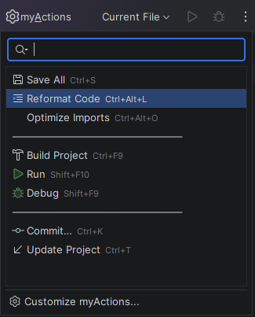
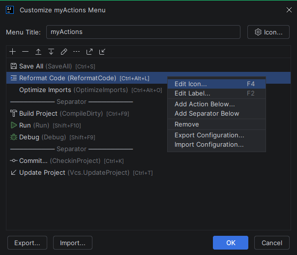

# MyActionsMenu

[](https://plugins.jetbrains.com/plugin/36112-myactionsmenu)
[](https://github.com/DaPa/MyActionsMenu/releases)
[](https://github.com/DaPa/MyActionsMenu/actions?query=workflow%3A%22Build+Plugin%22)
[](LICENSE)

[](https://github.com/DaPa/MyActionsMenu/graphs/contributors)
[](https://plugins.jetbrains.com/plugin/36112-myactionsmenu)
[](https://plugins.jetbrains.com/plugin/36112-myactionsmenu)
[](https://github.com/DaPa/MyActionsMenu/stargazers)

A powerful, customizable toolbar dropdown menu plugin for IntelliJ-based IDEs. **MyActionsMenu** consolidates scattered quick actions into a single compact, searchable menu on your main toolbar—maximizing screen real estate, eliminating visual clutter, and streamlining keyboard-driven workflows.

---

## Key Features





### 1. Compact & Searchable Toolbar Dropdown Menu
- **Space-Efficient Toolbar Widget:** Replaces a wide row of individual toolbar buttons with a single clean dropdown widget placed in the main toolbar.
- **Instant Search Filtering:** Type immediately when the menu opens to filter actions dynamically with real-time matching.
- **Keyboard Navigation & Fast Execution:** Navigate with `Up`/`Down`/`Page Up`/`Page Down`, execute with `Enter`, or dismiss with `Escape`.
- **Direct Shortcut Triggering:** Press any configured action's shortcut key (e.g., `F11`, `Ctrl+S`, `Ctrl+Alt+L`) directly while the menu is open to execute it immediately.
- **Mouse Hover Selection:** Smooth hover-tracking highlights menu items on cursor movement with single-click activation.
- **Persistent Dimension Clamping:** Remembers user-adjusted popup height and width across sessions, automatically constrained to safe bounds (capped at two-thirds of the IDE window height).
- **Adaptive Positioning:** Automatically anchors underneath the toolbar button, or centers beneath the top header when triggered without a visible toolbar widget.





### 2. Comprehensive Menu Customization Dialog
- **Manage Actions & Separators:** Add any registered IDE action, insert visual separator lines, reorder items, or remove entries.
- **Fast Action Chooser:** Search across tens of thousands of platform actions with background indexing, debounced filtering, and zero UI freezes.
- **Custom Display Labels:** Rename action labels (via `F2` or context menu) to create concise or context-specific descriptions in the menu.
- **Drag & Drop / Reordering Controls:** Easily move items up and down using toolbar controls, keyboard shortcuts, or context menus.

### 3. Full Icon Customization
- **Internal & External Icons:** Customize icons for individual menu items or for the main menu button itself.
  - **Internal IDE Icons:** Pick icons from any built-in platform action (e.g., `action:<ActionId>`).
  - **External Image Files:** Load custom image files supporting `.svg`, `.png`, `.ico`, `.jpg`, and `.gif` with automatic scaling.
- **Live Preview & Reset:** Real-time preview in the icon chooser dialog with a one-click reset to the action's default icon.
- **Contextual Access:** Edit icons directly via `F4`, right-click context menu, or the dialog toolbar button.

### 4. Configuration Export & Import (JSON)
- **Portable Menu Profiles:** Export your customized menu layout—including custom labels, internal/external icons, separators, and menu title—to a clean, human-readable JSON file.
- **Flexible Import Modes:** Import configurations with the option to either **Replace** existing items or **Append** to them.
- **Seamless Synchronization:** Easily share standardized team workflows or backup and sync settings across workstations.

### 5. Persistent State Management
- Seamlessly persists all menu items, custom labels, custom icons, menu title, and popup dimensions across IDE restarts using the IntelliJ Platform `@State` persistence service.

---

## Getting Started & Usage

### Opening the Menu
- **Toolbar Button:** Click the **myActions** button on the right side of the Main Toolbar.
- **Keyboard Shortcut:** Press `Alt+A` (or your custom shortcut configured in `Settings | Keymap`).
- **Tools Menu:** Select `Tools | myActions` from the main IDE menu.

### Customizing the Menu
1. Open the customization dialog via:
   - Clicking **Customize...** at the bottom of the quick actions popup menu.
   - Navigating to `Tools | Customize myActions Menu...`.
2. **Add Actions:** Click the `+` button (or right-click and choose **Add Action...**) to search and select any IDE action.
3. **Add Separator:** Click the separator icon (or right-click and choose **Add Separator**) to insert a visual divider.
4. **Edit Icon:** Select an item and press `F4` (or click **Edit Icon**) to select an internal IDE action icon or browse for an external image file.
5. **Rename / Custom Label:** Press `F2` (or click **Edit Label**) to override the default action text.
6. **Customize Menu Title & Icon:** In the top header of the customization dialog, update the menu title text or click the icon button to pick a custom icon for the main toolbar button.
7. **Export / Import:** Use the **Export...** and **Import...** buttons in the dialog footer or toolbar to save and restore `.json` configuration profiles.

---

## Configuration File Format (JSON)

Exported configurations use a clean JSON schema:

```json
{
  "menuTitle": "myActions",
  "menuIconPath": null,
  "items": [
    {
      "actionId": "SaveAll",
      "customText": "Save All Files",
      "customIconPath": "action:SaveAll",
      "isSeparator": false
    },
    {
      "actionId": "",
      "customText": "",
      "customIconPath": null,
      "isSeparator": true
    },
    {
      "actionId": "Git.Commit.Stage",
      "customText": "Commit & Push",
      "customIconPath": "/path/to/custom/git-icon.svg",
      "isSeparator": false
    }
  ]
}
```

---

## Building and Running from Source

### Prerequisites
- JDK 17 or later (JDK 21+ recommended)
- Gradle (handled via `./gradlew` wrapper)

### Common Gradle Tasks

| Task | Command | Description |
|---|---|---|
| **Run IDE with Plugin** | `./gradlew runIde` (or `.\gradlew.bat runIde`) | Launches a sandbox IDE instance with the plugin active. |
| **Run Unit & Integration Tests** | `./gradlew test` (or `.\gradlew.bat test`) | Executes all automated unit and platform test suites. |
| **Build Plugin Package** | `./gradlew build` (or `.\gradlew.bat build`) | Compiles and packages the plugin distribution ZIP in `build/distributions/`. |
| **Verify Plugin Compatibility** | `./gradlew verifyPlugin` | Runs IntelliJ plugin verification against target IDE builds. |

---

## Project Structure

```
.
├── src
│   ├── main
│   │   ├── kotlin/com/dapa1
│   │   │   ├── actions/          # IDE Action definitions (e.g. CustomizeMyActionsAction)
│   │   │   ├── model/            # Action item configuration data models
│   │   │   ├── settings/         # Persistent state service (MyActionsService)
│   │   │   ├── ui/               # Popup widget, dialogs, renderers, and custom UI components
│   │   │   └── util/             # Icon loading/scaling and JSON import/export helpers
│   │   └── resources
│   │       ├── META-INF/         # plugin.xml and plugin assets
│   │       └── messages/         # Localized message bundles
│   └── test
│       └── kotlin/com/dapa1      # Unit tests (Service, Widget, Shortcuts, Icons, Import/Export)
├── build.gradle.kts              # Build configuration and IntelliJ Platform Gradle Plugin setup
├── gradle.properties             # Build and platform version properties
└── settings.gradle.kts           # Gradle settings
```

---

## License

This project is licensed under the MIT License - see the [LICENSE](LICENSE) file for details.
